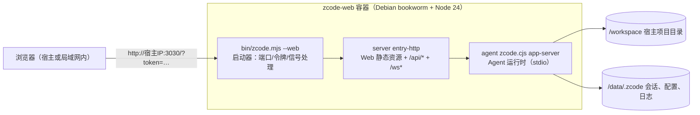

# ZCode 命令行版 Docker 构建与 B/S 运行指南

本文引导在 **x86_64 Ubuntu 宿主**上，仅凭 Docker 从本仓库源码构建 ZCode 命令行版（TUI + Web 发行包，即 `pnpm build:zcode` 的产物），并以 **B/S 模式**（`zcode --web`，浏览器访问 Web 界面）容器化运行。构建全部发生在容器内，宿主机不需要安装 Node.js、pnpm 或任何编译工具链。

相关文件：

| 文件 | 职责 |
| --- | --- |
| `Dockerfile.zcode` | 多阶段构建定义（builder → export → runtime） |
| `scripts/zcode-docker.sh` | 构建入口（薄封装：环境检查 + 参数解析 + 触发 docker build） |
| `scripts/zcode-distribution/docker-entrypoint.sh` | 运行镜像入口脚本（环境变量映射为 `zcode --web` 参数） |

## 1. 产物形态与架构

`Dockerfile.zcode` 提供三个 target：

| target | 产物 | 用途 |
| --- | --- | --- |
| `runtime`（默认） | `zcode-web:<version>` 镜像 | B/S 模式长驻服务：Web 界面 + HTTP/WS 后端 + Agent |
| `export` | `dist/zcode/releases/<版本>/zcode-<版本>.tar.gz` 等 | 官方发行包，落在宿主机，用于无 Docker 的主机（见第 6 节） |
| `builder` | 中间阶段 | 一般不单独使用 |

`scripts/zcode-docker.sh build` 会**先导出发行包到宿主 `dist/zcode/`，再构建运行镜像**，一次得到两种交付物；产物目录与官方本地构建 `pnpm build:zcode` 的默认输出一致。

B/S 模式运行架构（与桌面端无关，无 Electron）：



- 令牌鉴权只作用于 `/api/*` 与 `/ws*`；`/` 静态页面本身可访问但没有令牌无法使用功能。
- Agent 数据统一写入 `/data/.zcode`（`HOME=/data`、`ZCODE_DATA_BASE_DIR=/data`），与会话工作区 `/workspace` 分离。

## 2. 环境要求

- 宿主：x86_64 Linux（Ubuntu 20.04 及以上或任意现代发行版）。容器自带 Debian bookworm 用户态与 Node 24.14.0，宿主 glibc 版本不影响运行。
- Docker ≥ 23（含 BuildKit 与 buildx：`docker buildx version` 可用）。
- 磁盘：首次构建约需 15–20 GB（镜像层 + pnpm/electron/turbo 缓存卷）。
- 网络：构建期需访问 npm registry（默认 registry.npmjs.org，可换源，见参数表）、Debian 源与 electron 镜像。
- 仓库源码完整（`pnpm-lock.yaml` 在内），工作区建议保持干净以便产物可追溯。

## 3. 构建

> 日常重复构建直接看速查手册：[ZCode Docker 构建操作手册（SOP）](zcode-docker-build.md)。

### 3.1 一键脚本（推荐）

在仓库根目录执行：

```bash
scripts/zcode-docker.sh build          # 导出发行包到 dist/zcode/ + 构建 B/S 运行镜像（zcode-web:<版本> 与 zcode-web:latest）
scripts/zcode-docker.sh export         # 仅导出官方 tar.gz 发行包到 dist/zcode/
scripts/zcode-docker.sh build my-registry/zcode-web:v1   # 自定义镜像标签（可多个）
```

### 3.2 等效原生命令

```bash
# 运行镜像（默认 target 为 runtime；已导出过发行包时 builder 阶段直接命中缓存）
docker build -f Dockerfile.zcode -t zcode-web:latest .

# 发行包导出（tar.gz、sha256.txt、latest.json、install.sh）
docker build -f Dockerfile.zcode --target export --output type=local,dest=dist/zcode .
```

### 3.3 构建参数

| build-arg / 环境变量 | 默认值 | 说明 |
| --- | --- | --- |
| `ZCODE_DIST_BASE_URL` | `https://downloads.example.com/zcode/` | `build:zcode` 强制要求的下载根地址，仅写入 `install.sh`/`latest.json` 元数据，不影响镜像运行；发布到自建下载站时替换 |
| `ZCODE_ENV` | `production` | `test` / `production` 产品环境分流（内置 provider 配置与 Web 端点），默认与官方发布一致 |
| `ELECTRON_MIRROR` | `https://npmmirror.com/mirrors/electron/` | 容器内 electron devDependency 下载镜像，与 `mise.toml` 一致 |
| `NPM_REGISTRY` | 空（沿用仓库 `.npmrc`） | 非空时覆盖依赖下载源 |
| `PNPM_VERSION` | `10.33.2` | 构建期 pnpm 版本，与 `mise.toml` 一致 |
| `NODE_BUILD_IMAGE` | `node:24.14.0-bookworm` | builder 基础镜像；Node 版本与 `mise.toml` 一致 |
| `NODE_RUNTIME_IMAGE` | `node:24.14.0-bookworm-slim` | 运行镜像基础镜像，与 `mise.toml` 的 Node 版本一致 |

以上参数既可作为 build-arg 传入，也可通过同名环境变量经 `scripts/zcode-docker.sh` 透传。当网络无法访问 Docker Hub 时，用镜像源前缀覆盖两个基础镜像，例如：

```bash
NODE_BUILD_IMAGE=docker.m.daocloud.io/library/node:24.14.0-bookworm \
NODE_RUNTIME_IMAGE=docker.m.daocloud.io/library/node:24.14.0-bookworm-slim \
scripts/zcode-docker.sh build
```

### 3.4 缓存与可重复性

- 源码 `COPY` 进 builder 中间阶段（不对外发布），`.dockerignore` 约束上下文（排除 `.git`、`node_modules`、本地 `dist`、`.env*` 等）；`runtime` 镜像与 `export` 产物只包含发行包内容，不含仓库源码。
- 三类缓存卷跨次构建复用：`zcode-docker-pnpm-store`（依赖包）、`zcode-docker-electron-cache`（electron 二进制）、`zcode-docker-turbo-cache`（CLI 增量编译）。源码改动后的重建通常无需重新下载依赖。
- 版本取根 `package.json`（当前 3.16.2），产物内 `package.json`、`latest.json`、tar 包名一致，可追溯。
- 构建在 dirty 工作区会打印警告；正式发布前先提交，保证产物与 commit 对应。

## 4. B/S 模式运行

### 4.1 快速开始

```bash
docker run -d --name zcode-web \
  -p 3030:3030 \
  -v zcode-data:/data \
  -v "$PWD":/workspace \
  zcode-web:latest

# 从启动日志中获取带令牌的访问地址
docker logs zcode-web
```

日志中 `Local: http://127.0.0.1:3030/?token=…` 的 `token=` 即访问令牌；容器内打印的 Network 地址是容器内网 IP，实际访问用 `http://<宿主IP>:3030/?token=<令牌>`。浏览器打开后令牌写入 HttpOnly Cookie，后续访问不再需要携带。

### 4.2 访问令牌

`--host 0.0.0.0`（非回环地址）时 zcode 默认自动生成令牌。三种模式：

| 模式 | 设置方式 | 适用场景 |
| --- | --- | --- |
| 自动生成（默认） | 不设置任何变量 | 推荐：令牌打印在 `docker logs`，每次启动随机 |
| 固定令牌 | `-e ZCODE_WEB_TOKEN=<自定义令牌>` | 固定访问入口、脚本集成 |
| 关闭鉴权 | `-e ZCODE_WEB_NO_TOKEN=1` | 仅隔离可信网络；公网暴露必须开启令牌 |

### 4.3 数据与工作区挂载

| 容器路径 | 用途 | 建议 |
| --- | --- | --- |
| `/data` | 应用数据（实际在 `/data/.zcode`：会话库、账号与模型配置、日志） | 命名卷 `-v zcode-data:/data`，升级换镜像不丢数据 |
| `/workspace` | 默认工作区（Agent 的项目目录、`cwd`） | bind mount 宿主项目 `-v "$PWD":/workspace` |

首次使用在 Web 界面完成登录/Provider 配置，配置随 `/data` 卷持久化；升级 = 换新镜像标签重建容器。

### 4.4 Docker Compose 示例

```yaml
services:
  zcode-web:
    image: zcode-web:latest
    ports:
      - "3030:3030"
    volumes:
      - zcode-data:/data
      - ./my-project:/workspace
    environment:
      ZCODE_WEB_TOKEN: ""     # 留空 = 自动生成；也可固定令牌或配合 ZCODE_WEB_NO_TOKEN
    restart: unless-stopped
volumes:
  zcode-data:
```

### 4.5 验证

```bash
# 存活探测（`/` 为静态页，无需令牌）
curl -I http://127.0.0.1:3030/

# 容器内置 HEALTHCHECK（30s 间隔）状态
docker inspect --format '{{.State.Health.Status}}' zcode-web

# 带 API 令牌的接口验证（无令牌时返回 401，可确认鉴权生效）
curl -s -o /dev/null -w '%{http_code}\n' http://127.0.0.1:3030/api/v1/health
```

## 5. TUI 模式（可选）

同一镜像内含完整 TUI，覆盖入口即可交互式使用（需要 `-it` 分配 TTY）：

```bash
docker run -it --rm \
  -v zcode-data:/data \
  -v "$PWD":/workspace \
  --entrypoint zcode \
  zcode-web:latest
```

无参数进入 TUI；也可传 Agent CLI 参数（如 `--entrypoint zcode ... -- --help` 后接参数）。

## 6. 宿主机直接使用发行包（无 Docker 运行）

`scripts/zcode-docker.sh build` / `export` 之后，宿主机 `dist/zcode/` 即为发布文件：

```text
dist/zcode/
├── releases/<版本>/zcode-<版本>.tar.gz   # 运行包（含 TUI/Web/Agent 与原生依赖）
├── releases/<版本>/sha256.txt            # 校验摘要
├── latest.json                            # 版本索引
└── install.sh                             # 安装脚本（按 ZCODE_DIST_BASE_URL 下载）
```

在目标 x86_64 Ubuntu 主机（Ubuntu 20.04+，需自备 Node.js **24.14.0**，版本以 `mise.toml` 为准）：

```bash
sha256sum -c sha256.txt
mkdir -p ~/zcode-runtime && tar -xzf zcode-<版本>.tar.gz -C ~/zcode-runtime
node ~/zcode-runtime/zcode/bin/zcode.mjs --web --host 0.0.0.0 --port 3030 --no-open --workspace /path/to/project
```

监听非回环地址会自动生成访问令牌并打印在终端；参数与容器模式一致（`--token` 固定、`--no-token` 关闭）。也可把发行目录托管到下载站后用 `install.sh` 安装到 `~/.zcode/runtime`。

`install.sh` 支持三种安装方式，按优先级自动选择下载根地址：**显式 `ZCODE_DIST_BASE_URL` 环境变量 > 脚本同目录的 `latest.json`（本地安装，`file://` 直读）> 构建时烤入的下载站地址**。

```bash
# 方式一（推荐）：直接在构建产物目录里裸跑，自动检测同目录 latest.json 走本地文件
bash dist/zcode/install.sh

# 方式二：显式指定地址（file:// 本地目录或 http:// 下载站均可）
ZCODE_DIST_BASE_URL="file://$PWD/dist/zcode" bash dist/zcode/install.sh
```

两种方式都安装到 `~/.zcode/runtime`，并在 `~/.local/bin` 创建 `zcode` 命令。托管到下载站后，其他机器用 `curl -fsSL https://<下载站>/install.sh | sh` 一键安装。

## 7. 镜像环境变量参考

以下变量由镜像入口脚本 `docker-entrypoint.sh` 消费并转换为 `zcode --web` 参数，属于镜像层配置通道，不是 CLI 产品运行时变量：

| 变量 | 默认 | 说明 |
| --- | --- | --- |
| `ZCODE_WEB_HOST` | `0.0.0.0` | 监听地址；容器内必须为非回环地址，端口映射才能访问 |
| `ZCODE_WEB_PORT` | `3030` | 监听端口（同时影响 HEALTHCHECK 探测端口） |
| `ZCODE_WEB_WORKSPACE` | `/workspace` | 默认工作区路径 |
| `ZCODE_WEB_TOKEN` | 空 | 固定访问令牌 |
| `ZCODE_WEB_NO_TOKEN` | `0` | 设为 `1` 关闭令牌认证 |

`docker run <镜像> --port 8080 …` 末尾追加的参数原样透传给 `zcode --web`，同一选项后出现者优先。

## 8. 常见问题

| 现象 | 处理 |
| --- | --- |
| 本地 `bash install.sh` 报 `Could not resolve host: downloads.example.com` | 旧版脚本只认烤入的下载站地址；已支持同目录 `latest.json` 自动本地安装，直接在 `dist/zcode/` 里裸跑 `bash install.sh` 即可（见第 6 节） |
| 浏览器打开后无法登录/一直转圈 | 未携带有效令牌时页面会弹出「输入访问令牌」输入页：填入启动时传入或打印在终端/容器日志中的令牌即可，无需在 URL 里携带 `?token=`。也可直接用 `docker logs` 取 `?token=` 完整链接访问；确认使用宿主 IP 而非日志中的容器内网 IP。验证通过后浏览器会保存 30 天滑动续期的登录 cookie（`zcode_lite_token`），日常访问无需再次输入；更换浏览器、换用不同主机名/IP 访问、清理 Cookie、容器重启换新令牌（未固定 `ZCODE_WEB_TOKEN`）或连续 30 天未访问时，才需要重新验证一次 |
| 端口冲突 | 换映射端口 `-p 8080:3030`，或改监听端口 `-e ZCODE_WEB_PORT=8080 -p 8080:8080` |
| `/workspace` 内文件无写权限 | bind mount 目录属主与容器内 `node` 用户（uid 1000，官方 node 镜像内置）不一致：`chown -R 1000:1000` 或临时 `--user "$(id -u):$(id -g)"` |
| 构建报 `failed to resolve source metadata for docker.io/...` 超时 | Docker Hub 不可达：按 3.3 节用 `NODE_BUILD_IMAGE` / `NODE_RUNTIME_IMAGE` 指向镜像源前缀 |
| 构建期依赖下载慢/失败 | 用 `NPM_REGISTRY`、`ELECTRON_MIRROR` 指定镜像源；确认网络代理对 HTTPS npm/Debian 源放行 |
| 磁盘不足 | `docker builder prune` 清理构建缓存（缓存卷会一并清除，下次构建变慢） |
| 需要更换目标产品环境 | 构建时 `ZCODE_ENV=test scripts/zcode-docker.sh build`（连接测试环境服务） |
| 容器内 git/ssh 报错 | 镜像已内置 `git`、`openssh-client`；私钥凭据不要打进镜像，用 `docker cp` 或挂载只读 `-v ~/.ssh:/home/zcode/.ssh:ro` 方式注入并注意属主 |

## 9. 与仓库其他构建入口的关系

- `pnpm build:zcode`（`scripts/build-zcode.mjs`）：官方本地构建入口，需在宿主准备 Node 24.14.0 + pnpm 10.33.2；本文 Docker 流程即该命令的容器化封装，产物一致。
- `Dockerfile.desktop-e2e`：桌面 Electron E2E 专用镜像，与命令行版发行无关。
- `pnpm dev:web`：源码开发模式（Vite dev server + 后端热更新），面向仓库开发者；本文面向构建与部署最终产物。
- `docs/web-app-docker-image.md`：历史 Web App 镜像 spec（基于桌面 agent bundle 链路），其入口未落地；命令行版 B/S 部署以本文为准。
